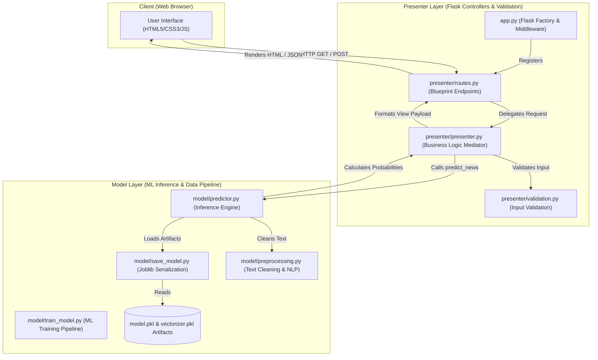
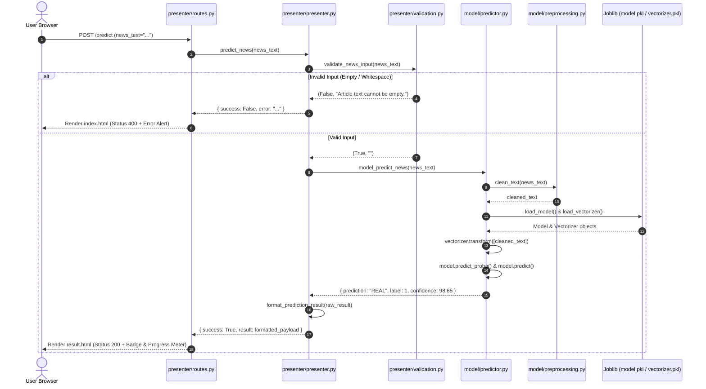

# System Architecture: Fake News Detection Application

## 1. Executive Summary

The **Fake News Detection System** is structured using the **Model-View-Presenter (MVP)** software architecture pattern. This architectural choice enforces strict separation of concerns, decoupling Machine Learning model training and inference logic from HTTP routing, request validation, and user interface rendering.

---

## 2. High-Level System Architecture

---

## 3. Data Flow Sequence Diagram

---

## 4. MVP Architecture & Layer Responsibilities

### 4.1. Model Layer (`model/`)
- **Isolation**: Pure Python code with no dependencies on Flask or web request contexts.
- **`model/preprocessing.py`**: Executes NLP text cleaning (stripping special characters, removing extra whitespace, lowercasing).
- **`model/train_model.py`**: Trains Logistic Regression classifier on `dataset/cleaned_news.csv`, logs environment package versions, and serializes trained objects.
- **`model/save_model.py`**: Utility functions wrapping `joblib.dump` and `joblib.load` with robust error messaging.
- **`model/predictor.py`**: Singleton artifact loader and inference module computing prediction classes and confidence percentages.

### 4.2. Presenter Layer (`presenter/`)
- **Mediator Role**: Serves as the middle layer between View and Model.
- **`presenter/routes.py`**: Defines Flask Blueprint `presenter_bp` for endpoints (`/`, `/predict`, `/about`, `/health`).
- **`presenter/validation.py`**: Implements input validation rules checking character lengths and non-empty strings.
- **`presenter/presenter.py`**: Coordinates request validation, invokes Model predictor, and formats structured payloads for template rendering.

### 4.3. View Layer (`view/`)
- **Passive View**: Displays UI elements and forwards user form submissions. Contains zero business logic or ML model references.
- **`view/templates/`**: Jinja2 templates (`base.html`, `index.html`, `result.html`).
- **`view/static/`**: Custom CSS styling (`style.css`) and client-side interactivity (`script.js`).

---

## 5. Architectural Benefits

1. **Testability**: Presenter logic and Model layer can be unit-tested independently without mocking HTTP request contexts.
2. **Resilience**: Model loading errors or scikit-learn version mismatches are caught gracefully in `predictor.py` and returned as readable error messages instead of causing unhandled web server crashes.
3. **Maintainability**: Swapping out ML algorithms (e.g. replacing Logistic Regression with BERT) only requires updating `model/predictor.py` while leaving Presenter and View layers completely unchanged.
