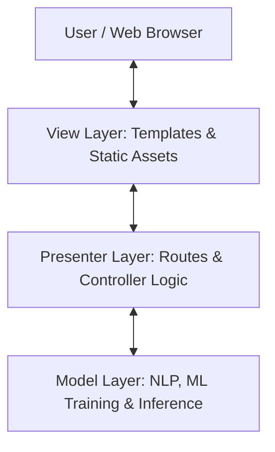

# Architecture Overview: Fake News Detection System (MVP Pattern)

## Overview
The application is built using the **Model-View-Presenter (MVP)** architectural pattern to achieve clean separation of concerns, high maintainability, and testability.

## Layer Responsibilities

### 1. Model Layer (`model/`)
- Pure Python & Machine Learning code.
- Data cleaning (`preprocessing.py`), Dataset management (`train_model.py`).
- Inference execution (`predictor.py`) and serialization (`save_model.py`).
- Completely decoupled from Flask web logic and UI templates.

### 2. Presenter Layer (`presenter/`)
- Acts as mediator between View and Model.
- Handles Flask routes (`routes.py`), request parameter processing, input validation (`validation.py`), and formats JSON/Template payloads (`presenter.py`).
- Views never communicate directly with the Model.

### 3. View Layer (`view/`)
- HTML5 templates (`view/templates/`), Jinja2 rendering.
- Bootstrap 5 CSS styling (`view/static/css/`) and interactive JavaScript (`view/static/js/`).
